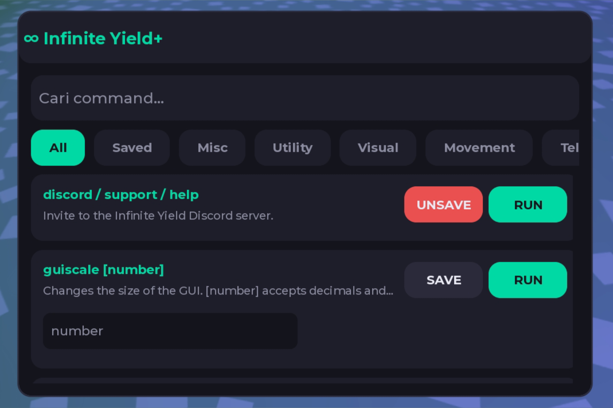

# InfiniteYieldPlus



An alternative UI for [IY FE (Infinite Yield FE)](https://github.com/EdgeIY/infiniteyield),
designed specifically for **Mobile and PC**. It features command search
and a favorites system all without requiring a fork of the original IY source code.

This script is useful when you want to search command.

> I making this because IY FE (Infinite Yield FE) UI is horrible when you searching some command, especially for mobile. 
> This is just for fun, don't be seriously about this script thing. Because if you want for quick use, I recommend using the original IY FE.

## Installation

1. Ensure **Infinite Yield FE** is already running.
2. Execute `dist/InfiniteYieldPlus.lua` via your executor, or copy this script below:

```luau
loadstring(game:HttpGet(
  "https://raw.githubusercontent.com/LucidSc1pt/Roblox/main/infinite-yield-plus/dist/InfiniteYieldPlus.lua"
))()
```

## Features
- Responsive layout, automatically adapts between mobile/tablet and desktop modes
- Real-time command search, like the original IY FE.
- Category tabs (Movement, Combat, Teleport, Visual, Utility)
- **Run** and **Save** buttons for every command
- Favorites list persists across sessions (provided your executor supports `writefile`)

> Important: Your executor must have **writefile and readfile** function or the saving function will not work.

# Folder Structure
```
InfiniteYieldPlus/
├── README.md                  → installation guide, screenshots, roadmap
├── src/
│   ├── init.lua
│   ├── Core/
│   │   ├── IYBridge.lua
│   │   ├── Registry.lua
│   │   └── Saved.lua
│   ├── UI/
│   │   ├── Theme.lua
│   │   ├── Layout.lua
│   │   ├── Builder.lua
│   │   ├── CommandRow.lua
│   │   └── TabBar.lua
│   └── Data/
│       └── commands.lua        → raw command data (name + description + category)
└── dist/
    └── InfiniteYieldPlus.lua   → single-file build for use with loadstring
```

Vibecoded project with DeepSeek.

# License
Open Source.
Free to use and modify whatever you want.